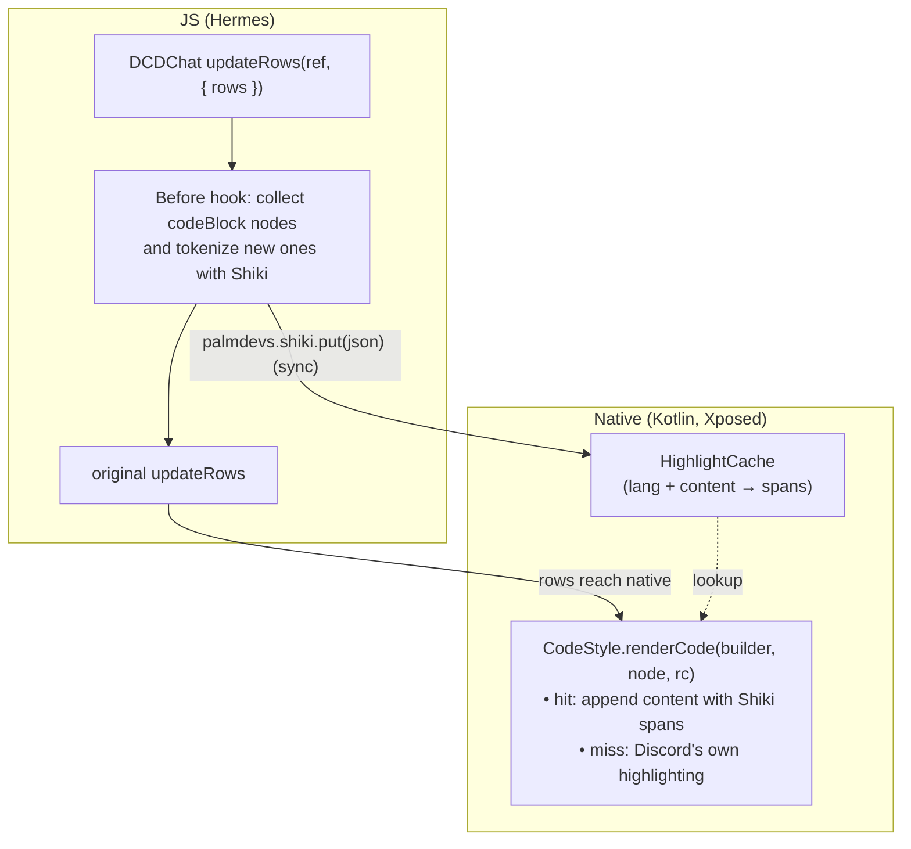

# Shiki Codeblocks

Highlights code blocks in chat with [Shiki](https://shiki.style), the TextMate grammar highlighter VS Code uses, instead of Discord's built-in highlighter.
Pick a theme for Discord's dark themes and one for its light theme in the plugin settings.
Tap a code block to open it in a viewer, where its text can be selected and copied (can be turned off in settings).

## Architecture

Discord renders chat natively. JS turns messages into rows (a JSON-like tree of content nodes) and sends them to the native chat list, which turns each code block node into Android spans.
Shiki only runs in JS, so the plugin has two halves that meet in a cache:



### JS

- `index.ts` patches `updateRows` of the `DCDChat` view commands, the last stop before rows go to native.
  It collects every `{ type: 'codeBlock', lang, content }` node in the rows (messages, embeds, forwards) and stores their highlights natively with one **synchronous** call, so they are cached before the rows that need them are rendered.
  Every update sends all of its blocks, even ones sent before, so native never has to remember them. The last 256 highlights are memoized in JS, so blocks aren't tokenized again.
  The theme follows `ThemeStore.theme`. Toggling light/dark makes Discord send every row again, so the blocks get the other theme's highlights.
- `highlighter.ts` runs Shiki with its JavaScript regex engine, targeting ES2018: Hermes has no WebAssembly (needed by the Oniguruma engine) and no RegExp `v` flag.
  Tokens become flat `start, end, color, fontStyle` spans. Tokens in the theme's default color are dropped, and adjacent ones with the same style are merged.
  Colors are sent as signed ARGB ints, ready for Android.
- `assets.ts` reads grammars and themes from the plugin's `assets/shiki` on first use (see [Assets](#assets)).

### Native (Android)

- `CodeStyleHooks.kt` hooks Discord's `com.discord.chat.presentation.textutils.CodeStyle`:
  - `renderCodeBlock` sets up the block (background, code font, padding) and calls `renderCode`, which appends the highlighted content.
  - `renderCode` is replaced on a cache hit: the content is appended with Shiki's colors, bold, italic, underline and strikethrough as spans. Hidden spoilers keep Discord's rendering.
  - After `renderCodeBlock`, the block's `BlockBackgroundSpan` is repainted in the theme's background color, so the theme stays readable.
  - Each `CodeBlockContentNode` takes its highlight from the cache when it's created (right after JS stored it), and keeps it in a weak map for as long as Discord keeps the node.
    Rows are rendered again whenever they scroll back into view, so this keeps them highlighted even after the cache dropped their blocks.
- `Highlights.kt` holds the `HighlightCache`, an LRU of 512 blocks keyed by language and content. It only hands highlights to the nodes of one row update.
- `CodeViewer.kt` makes code blocks tappable and shows the viewer.
  Message text uses Discord's own touch handling (`NestedScrollOnTouchTracker`), which only taps spans implementing `NestedClickableSpan`.
  That interface is in Discord's class loader, so the spans are `java.lang.reflect.Proxy`s of it, set over the block after `renderCodeBlock`.
  They expand to line bounds so the whole block is tappable, and hand long presses to the message row's own listener (`getNestedLongClickListener`), so they open the message actions like anywhere else in the message.
  The viewer is a dialog with the same spans in a selectable `TextView`, in Discord's code font, scrolling horizontally.
  JS tells native whether it's enabled (`palmdevs.shiki.setOpenOnTap`), which is checked on every tap.

`ansi` blocks are colored like on desktop, with the theme's terminal palette. Discord strips their escape sequences before rows reach native, so `ansi.ts` finds the raw block in the stored message (`MessageStore`, including forwards) by its stripped text, and highlights that. ANSI is built into Shiki, and its tokens leave out escape sequences, so JS sends the shown text (`text`) and background colors (`backgrounds`) along with the spans.
Blocks in languages that aren't shipped, or over 20,000 characters, are left plain in the theme's colors, to match the rest.
Anything unexpected falls back to Discord's own highlighting instead of breaking chat: cache misses and JS errors.

### Assets

Grammar and themes are stored in `assets/shiki`, and are read when a code block first needs them:

- `langs/<name>.json`: one grammar each. A grammar's `embeddedLangs` (eg. CSS and JavaScript in HTML) are loaded first.
- `themes/<name>.json`
- `index.json`: language names and aliases to their grammar, and theme labels and types for the settings.

They are generated from the `shiki` package. To ship more languages or themes, add them to `shiki.config.ts` and run:

```sh
bun run --cwd plugins/shiki-codeblocks generate
```

Then commit the regenerated `assets/shiki`.

### Limitations

- Changing a theme in settings needs a reload (turning Open on tap on or off doesn't). Rows already rendered keep their highlights, and Discord doesn't send them again.
- The first block in a language is naturally slower, as its grammar is read and compiled then.
- Fenced code inside a `markdown` code block isn't highlighted, as the languages Markdown embeds lazily aren't loaded.
